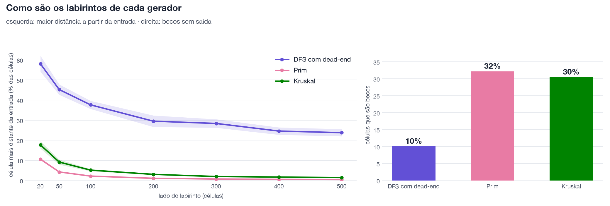
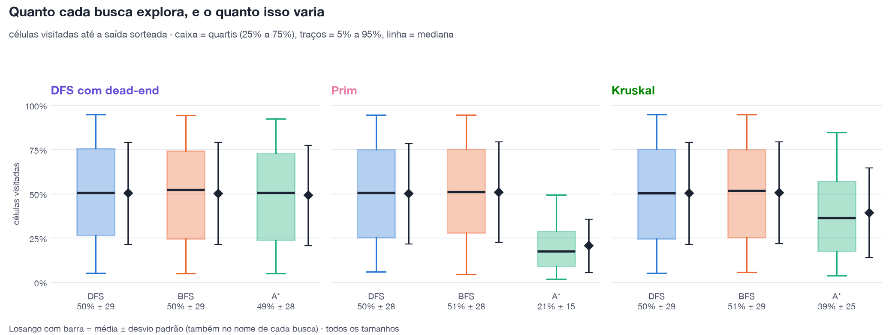
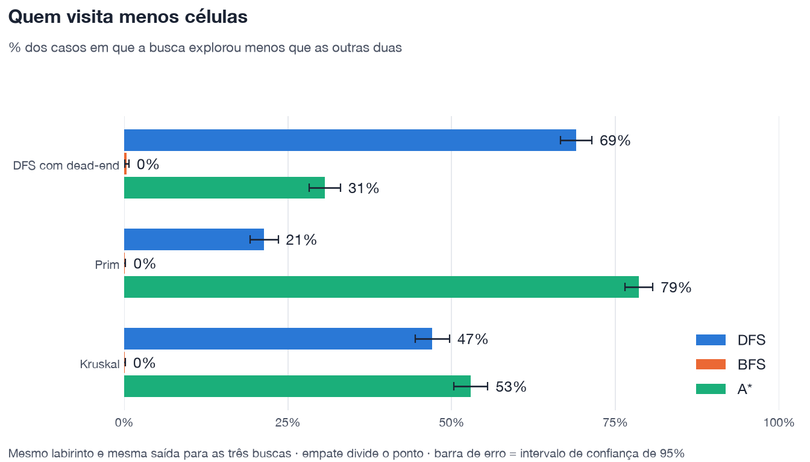
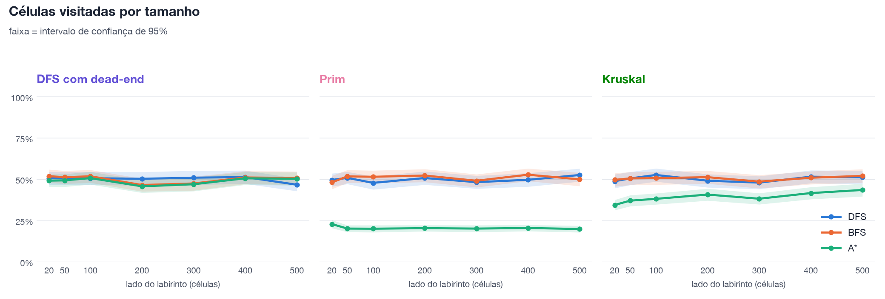
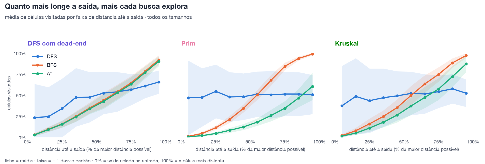
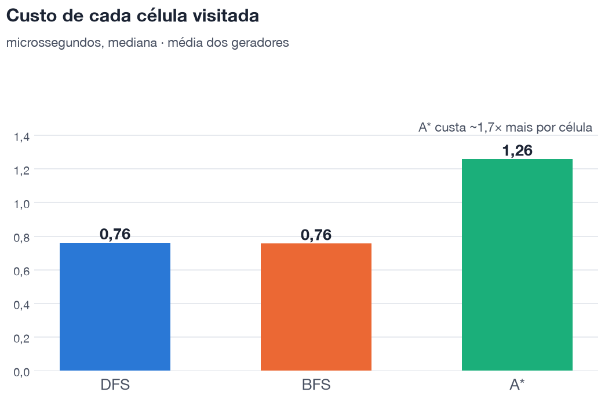
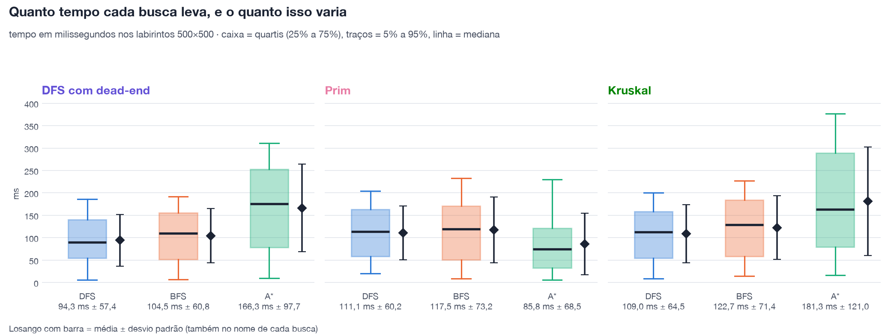
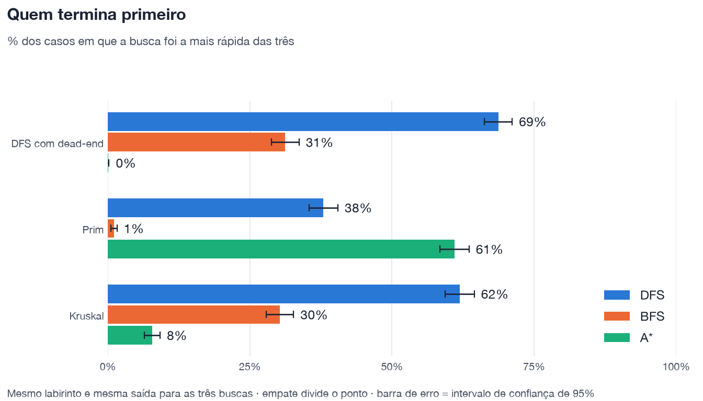
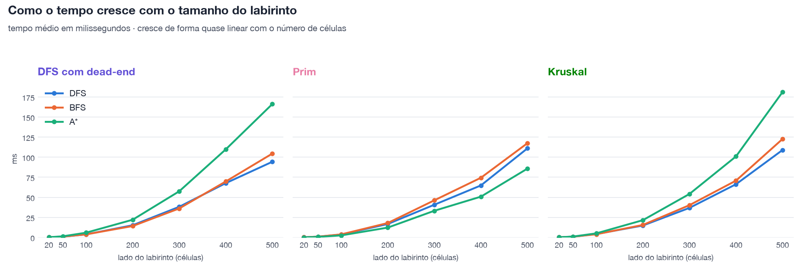
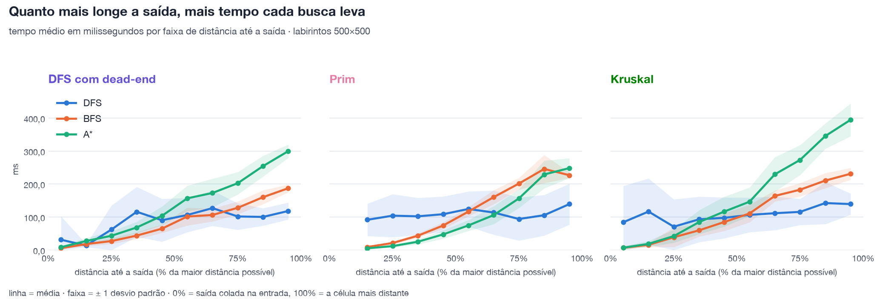

# Comparativo de solvers por builder

Gerado por `python3 benchmark.py`. Configuracao desta rodada:

- Tamanhos: 20x20, 50x50, 100x100, 200x200, 300x300, 400x400, 500x500
- 10 labirintos por builder e tamanho (210 labirintos no total)
- Entrada sempre no canto superior esquerdo; saida sorteada em qualquer celula, via `Maze.solve(random_end=True)`: 20 saidas por labirinto (200 amostras por builder e tamanho)
- Tempo: mediana de 3 repeticoes de cada solve

Como ler:

- **Celulas visitadas**: fracao do labirinto que o solver visitou ate achar a saida. Quanto menor, melhor. O `±` e a meia-largura do intervalo de confianca de 95% da media.
- **Vitorias**: em quantos % dos casos o solver visitou menos celulas (ou foi mais rapido) que os outros dois, no mesmo labirinto e com a mesma saida. Empates dividem o ponto.
- **Distancia relativa ate a saida**: passos da entrada ate a saida divididos pela maior distancia possivel a partir da entrada naquele labirinto (0% = colada na entrada, 100% = a celula mais distante).
- Os labirintos sao perfeitos (so existe um caminho), entao os tres solvers acham o mesmo caminho. O que muda e quanto exploram ate acha-lo.

## Labirintos gerados

Becos sem saida, em % das celulas (media de todos os tamanhos):

| dead_end_dfs | randomized_kruskal | randomized_prim |
|---|---|---|
| 10.0% | 30.4% | 32.2% |

Tamanho medio dos corredores, em celulas (media de todos os tamanhos):

| dead_end_dfs | randomized_kruskal | randomized_prim |
|---|---|---|
| 5.9 ±0.0 | 1.7 ±0.0 | 1.7 ±0.0 |

Maior distancia a partir da entrada, em % das celulas:

| Tamanho | dead_end_dfs | randomized_kruskal | randomized_prim |
|---|---|---|---|
| 20x20 | 58.1% | 17.7% | 10.6% |
| 50x50 | 45.2% | 9.2% | 4.2% |
| 100x100 | 37.6% | 5.1% | 2.2% |
| 200x200 | 29.5% | 3.0% | 1.1% |
| 300x300 | 28.4% | 2.0% | 0.7% |
| 400x400 | 24.6% | 1.7% | 0.5% |
| 500x500 | 23.8% | 1.5% | 0.4% |

Caminho ate a saida dividido pela distancia de Manhattan (mediana):

| Escopo | dead_end_dfs | randomized_kruskal | randomized_prim |
|---|---|---|---|
| todos os tamanhos | 26.10 | 2.76 | 1.14 |
| 500x500 | 70.73 | 3.48 | 1.13 |

## Celulas visitadas

Celulas visitadas (todos os tamanhos): media, desvio padrao, mediana, quartis (25% a 75%) e extremos (5% a 95%):

| Builder | Busca | Media | Desvio | Mediana | Quartis | Extremos |
|---|---|---|---|---|---|---|
| dead_end_dfs | a_star | 49.1% | 28.4 | 50.7% | 23.9% a 72.8% | 4.9% a 92.4% |
| dead_end_dfs | bfs | 50.2% | 28.8 | 52.3% | 24.5% a 74.3% | 5.1% a 94.3% |
| dead_end_dfs | dfs | 50.3% | 28.8 | 50.7% | 26.5% a 75.8% | 5.2% a 94.8% |
| randomized_kruskal | a_star | 39.2% | 25.3 | 36.4% | 17.5% a 57.3% | 3.9% a 84.8% |
| randomized_kruskal | bfs | 50.6% | 28.7 | 51.8% | 25.2% a 74.9% | 5.8% a 94.7% |
| randomized_kruskal | dfs | 50.4% | 28.9 | 50.5% | 24.5% a 75.2% | 5.2% a 94.9% |
| randomized_prim | a_star | 20.7% | 15.1 | 17.7% | 9.1% a 28.9% | 1.7% a 49.5% |
| randomized_prim | bfs | 50.9% | 28.4 | 51.1% | 28.0% a 75.2% | 4.5% a 94.5% |
| randomized_prim | dfs | 50.0% | 28.5 | 50.6% | 25.2% a 75.0% | 6.1% a 94.5% |

Vitorias (visitou menos celulas):

| Builder | a_star | bfs | dfs | Melhor |
|---|---|---|---|---|
| dead_end_dfs | 31% | 0% | 69% | **dfs** |
| randomized_kruskal | 53% | 0% | 47% | **a_star** |
| randomized_prim | 79% | 0% | 21% | **a_star** |

**dead_end_dfs**

| Tamanho | a_star | bfs | dfs |
|---|---|---|---|
| 20x20 | 49.3% ±3.9 | 52.0% ±4.0 | 50.8% ±3.9 |
| 50x50 | 49.4% ±3.9 | 51.3% ±3.9 | 50.7% ±3.8 |
| 100x100 | 50.8% ±3.8 | 51.9% ±3.9 | 50.8% ±3.9 |
| 200x200 | 45.8% ±3.8 | 46.6% ±3.9 | 50.4% ±4.1 |
| 300x300 | 47.1% ±4.2 | 47.6% ±4.2 | 51.1% ±4.3 |
| 400x400 | 50.7% ±3.9 | 51.2% ±3.9 | 51.4% ±4.0 |
| 500x500 | 50.4% ±4.0 | 50.9% ±4.0 | 46.8% ±3.8 |

**randomized_kruskal**

| Tamanho | a_star | bfs | dfs |
|---|---|---|---|
| 20x20 | 34.5% ±3.1 | 49.8% ±4.0 | 48.9% ±4.2 |
| 50x50 | 37.1% ±3.3 | 50.7% ±3.9 | 50.6% ±4.0 |
| 100x100 | 38.2% ±3.4 | 50.8% ±3.9 | 52.7% ±4.0 |
| 200x200 | 40.8% ±3.6 | 51.4% ±3.9 | 49.2% ±4.0 |
| 300x300 | 38.3% ±3.4 | 48.7% ±4.0 | 48.1% ±3.9 |
| 400x400 | 41.7% ±3.7 | 51.0% ±3.9 | 51.7% ±3.9 |
| 500x500 | 43.6% ±3.9 | 52.2% ±4.1 | 51.3% ±4.0 |

**randomized_prim**

| Tamanho | a_star | bfs | dfs |
|---|---|---|---|
| 20x20 | 23.0% ±2.4 | 48.2% ±4.1 | 49.7% ±4.0 |
| 50x50 | 20.2% ±2.1 | 51.9% ±3.9 | 51.0% ±3.7 |
| 100x100 | 20.1% ±2.2 | 51.6% ±3.8 | 47.9% ±4.0 |
| 200x200 | 20.5% ±1.9 | 52.4% ±3.9 | 50.9% ±4.0 |
| 300x300 | 20.2% ±2.1 | 49.2% ±3.9 | 48.4% ±3.9 |
| 400x400 | 20.6% ±1.9 | 52.9% ±3.8 | 49.8% ±4.1 |
| 500x500 | 20.0% ±2.0 | 50.1% ±4.1 | 52.7% ±3.9 |

## Distancia ate a saida e celulas visitadas

**dead_end_dfs** (media ± desvio padrao de celulas visitadas por faixa de distancia relativa; n = amostras)

| Distancia | n | a_star | bfs | dfs |
|---|---|---|---|---|
| 0-10% | 75 | 2.7% ±1.6 | 2.8% ±1.7 | 23.2% ±40.0 |
| 10-20% | 103 | 8.9% ±2.8 | 9.3% ±2.9 | 24.3% ±35.0 |
| 20-30% | 100 | 15.3% ±4.0 | 15.6% ±4.1 | 33.9% ±35.6 |
| 30-40% | 117 | 24.0% ±5.8 | 24.6% ±6.0 | 47.3% ±34.7 |
| 40-50% | 117 | 33.6% ±6.2 | 34.7% ±6.5 | 47.4% ±29.8 |
| 50-60% | 142 | 42.3% ±8.8 | 43.7% ±9.0 | 52.3% ±25.0 |
| 60-70% | 141 | 52.6% ±8.6 | 53.9% ±8.6 | 53.8% ±23.4 |
| 70-80% | 219 | 62.9% ±8.2 | 64.4% ±8.2 | 56.4% ±18.5 |
| 80-90% | 194 | 76.5% ±7.3 | 78.0% ±7.0 | 60.7% ±14.5 |
| 90-100% | 192 | 90.0% ±5.8 | 91.7% ±5.4 | 65.4% ±13.7 |

**randomized_kruskal** (media ± desvio padrao de celulas visitadas por faixa de distancia relativa; n = amostras)

| Distancia | n | a_star | bfs | dfs |
|---|---|---|---|---|
| 0-10% | 44 | 1.2% ±1.0 | 1.8% ±1.5 | 37.1% ±47.4 |
| 10-20% | 77 | 4.7% ±1.9 | 7.6% ±3.5 | 48.4% ±45.3 |
| 20-30% | 126 | 10.7% ±4.3 | 15.8% ±6.3 | 43.3% ±38.1 |
| 30-40% | 149 | 17.7% ±6.0 | 24.6% ±7.1 | 46.8% ±34.6 |
| 40-50% | 158 | 26.2% ±8.7 | 35.1% ±9.8 | 49.0% ±29.2 |
| 50-60% | 210 | 36.9% ±10.5 | 49.4% ±11.4 | 51.8% ±25.8 |
| 60-70% | 205 | 47.1% ±12.6 | 63.1% ±10.2 | 51.3% ±23.4 |
| 70-80% | 214 | 57.1% ±12.9 | 74.5% ±8.5 | 54.0% ±19.4 |
| 80-90% | 141 | 71.8% ±12.6 | 88.1% ±5.4 | 57.3% ±17.4 |
| 90-100% | 76 | 87.0% ±9.5 | 96.9% ±2.7 | 52.1% ±16.3 |

**randomized_prim** (media ± desvio padrao de celulas visitadas por faixa de distancia relativa; n = amostras)

| Distancia | n | a_star | bfs | dfs |
|---|---|---|---|---|
| 0-10% | 30 | 0.5% ±0.4 | 1.0% ±0.6 | 46.7% ±44.1 |
| 10-20% | 65 | 1.7% ±1.1 | 4.3% ±1.8 | 47.2% ±34.6 |
| 20-30% | 98 | 4.3% ±1.7 | 11.1% ±2.4 | 54.3% ±31.9 |
| 30-40% | 147 | 8.1% ±2.8 | 21.0% ±4.1 | 47.7% ±29.5 |
| 40-50% | 202 | 12.1% ±3.6 | 34.1% ±4.7 | 48.0% ±27.6 |
| 50-60% | 273 | 17.8% ±4.4 | 50.2% ±5.9 | 51.0% ±26.9 |
| 60-70% | 269 | 25.7% ±6.8 | 67.5% ±6.4 | 50.3% ±28.3 |
| 70-80% | 181 | 34.3% ±8.5 | 84.1% ±4.4 | 51.1% ±26.0 |
| 80-90% | 100 | 46.5% ±10.8 | 93.4% ±2.3 | 51.1% ±26.0 |
| 90-100% | 35 | 60.3% ±16.1 | 98.6% ±1.3 | 50.6% ±23.3 |

## Tempo de execucao

Tempo em ms nos labirintos 500x500: media, desvio padrao, mediana, quartis e extremos:

| Builder | Busca | Media | Desvio | Mediana | Quartis | Extremos |
|---|---|---|---|---|---|---|
| dead_end_dfs | a_star | 166.3 | 97.7 | 175.9 | 78.7 a 253.1 | 9.7 a 310.8 |
| dead_end_dfs | bfs | 104.5 | 60.8 | 110.1 | 51.5 a 155.3 | 6.5 a 192.2 |
| dead_end_dfs | dfs | 94.3 | 57.4 | 89.5 | 54.5 a 140.7 | 5.9 a 185.7 |
| randomized_kruskal | a_star | 181.3 | 121.0 | 163.6 | 79.4 a 288.8 | 16.5 a 377.0 |
| randomized_kruskal | bfs | 122.7 | 71.4 | 128.9 | 58.9 a 183.9 | 14.1 a 226.9 |
| randomized_kruskal | dfs | 109.0 | 64.5 | 112.6 | 54.2 a 158.9 | 8.6 a 200.5 |
| randomized_prim | a_star | 85.8 | 68.5 | 74.3 | 32.6 a 121.2 | 5.8 a 230.4 |
| randomized_prim | bfs | 117.5 | 73.2 | 119.5 | 51.1 a 170.5 | 9.2 a 233.2 |
| randomized_prim | dfs | 111.1 | 60.2 | 114.0 | 58.4 a 163.1 | 19.9 a 204.3 |

Vitorias por tempo (foi a mais rapida):

| Builder | a_star | bfs | dfs | Mais rapida |
|---|---|---|---|---|
| dead_end_dfs | 0% | 31% | 69% | **dfs** |
| randomized_kruskal | 8% | 30% | 62% | **dfs** |
| randomized_prim | 61% | 1% | 38% | **a_star** |

Custo por celula visitada (µs, mediana):

| Builder | a_star | bfs | dfs |
|---|---|---|---|
| dead_end_dfs | 1.17 | 0.73 | 0.75 |
| randomized_kruskal | 1.29 | 0.75 | 0.77 |
| randomized_prim | 1.32 | 0.78 | 0.77 |

**dead_end_dfs** (tempo medio, ms)

| Tamanho | a_star | bfs | dfs |
|---|---|---|---|
| 20x20 | 0.20 | 0.14 | 0.14 |
| 50x50 | 1.38 | 0.94 | 0.92 |
| 100x100 | 5.88 | 3.79 | 3.75 |
| 200x200 | 22.03 | 14.16 | 15.16 |
| 300x300 | 57.49 | 36.10 | 38.17 |
| 400x400 | 109.80 | 69.75 | 67.68 |
| 500x500 | 166.30 | 104.53 | 94.33 |

**randomized_kruskal** (tempo medio, ms)

| Tamanho | a_star | bfs | dfs |
|---|---|---|---|
| 20x20 | 0.16 | 0.14 | 0.14 |
| 50x50 | 1.06 | 0.89 | 0.91 |
| 100x100 | 5.04 | 3.94 | 4.22 |
| 200x200 | 21.49 | 15.53 | 14.82 |
| 300x300 | 54.16 | 40.19 | 36.80 |
| 400x400 | 100.99 | 70.79 | 66.31 |
| 500x500 | 181.27 | 122.75 | 109.00 |

**randomized_prim** (tempo medio, ms)

| Tamanho | a_star | bfs | dfs |
|---|---|---|---|
| 20x20 | 0.11 | 0.14 | 0.14 |
| 50x50 | 0.61 | 0.93 | 0.92 |
| 100x100 | 2.51 | 3.75 | 3.60 |
| 200x200 | 12.23 | 17.95 | 16.73 |
| 300x300 | 33.21 | 46.25 | 40.74 |
| 400x400 | 50.82 | 74.37 | 64.80 |
| 500x500 | 85.80 | 117.48 | 111.06 |

## Distancia ate a saida e tempo (500x500)

**dead_end_dfs** (tempo medio ± desvio padrao, em ms, por faixa de distancia relativa)

| Distancia | n | a_star | bfs | dfs |
|---|---|---|---|---|
| 0-10% | 15 | 8.26 ±3.67 | 5.37 ±2.36 | 31.07 ±71.22 |
| 10-20% | 11 | 27.30 ±9.58 | 17.91 ±6.00 | 13.55 ±4.73 |
| 20-30% | 11 | 43.08 ±13.37 | 27.02 ±8.42 | 62.03 ±73.15 |
| 30-40% | 13 | 68.28 ±17.48 | 43.64 ±10.78 | 115.84 ±75.72 |
| 40-50% | 19 | 103.64 ±28.35 | 64.71 ±12.79 | 90.18 ±64.92 |
| 50-60% | 16 | 156.56 ±38.80 | 101.45 ±27.09 | 106.17 ±52.05 |
| 60-70% | 23 | 172.92 ±43.35 | 106.15 ±19.71 | 126.95 ±53.68 |
| 70-80% | 30 | 202.52 ±33.96 | 127.91 ±19.36 | 101.60 ±40.22 |
| 80-90% | 36 | 254.29 ±31.58 | 160.08 ±21.07 | 100.24 ±26.54 |
| 90-100% | 26 | 299.74 ±20.42 | 187.28 ±11.85 | 118.24 ±25.58 |

**randomized_kruskal** (tempo medio ± desvio padrao, em ms, por faixa de distancia relativa)

| Distancia | n | a_star | bfs | dfs |
|---|---|---|---|---|
| 0-10% | 5 | 6.89 ±5.00 | 6.66 ±5.37 | 84.11 ±110.39 |
| 10-20% | 14 | 18.56 ±9.09 | 15.52 ±6.02 | 116.54 ±100.58 |
| 20-30% | 17 | 42.04 ±19.83 | 38.59 ±29.89 | 70.58 ±83.13 |
| 30-40% | 21 | 84.47 ±36.25 | 59.57 ±18.78 | 92.96 ±69.05 |
| 40-50% | 21 | 116.54 ±45.51 | 84.86 ±26.94 | 97.54 ±62.01 |
| 50-60% | 33 | 146.47 ±43.28 | 110.76 ±26.68 | 106.46 ±52.34 |
| 60-70% | 24 | 229.38 ±52.38 | 163.90 ±16.72 | 111.47 ±51.29 |
| 70-80% | 32 | 273.12 ±45.32 | 182.79 ±20.41 | 115.54 ±39.74 |
| 80-90% | 22 | 345.60 ±38.47 | 210.45 ±23.00 | 142.31 ±63.63 |
| 90-100% | 11 | 394.73 ±49.85 | 231.15 ±18.01 | 139.21 ±32.17 |

**randomized_prim** (tempo medio ± desvio padrao, em ms, por faixa de distancia relativa)

| Distancia | n | a_star | bfs | dfs |
|---|---|---|---|---|
| 0-10% | 4 | 0.95 ±0.44 | 1.90 ±0.66 | 151.42 ±67.44 |
| 10-20% | 11 | 5.11 ±1.64 | 9.04 ±2.41 | 91.59 ±49.03 |
| 20-30% | 20 | 11.72 ±3.54 | 21.10 ±4.88 | 104.06 ±65.39 |
| 30-40% | 18 | 25.01 ±7.87 | 43.26 ±6.96 | 102.10 ±56.10 |
| 40-50% | 21 | 47.23 ±12.97 | 74.16 ±9.85 | 108.46 ±53.87 |
| 50-60% | 43 | 74.41 ±16.45 | 116.31 ±14.01 | 124.38 ±53.22 |
| 60-70% | 43 | 105.74 ±27.35 | 160.26 ±21.47 | 113.61 ±67.11 |
| 70-80% | 22 | 156.30 ±28.39 | 201.31 ±17.78 | 93.96 ±65.27 |
| 80-90% | 12 | 229.07 ±42.14 | 245.70 ±42.75 | 105.44 ±61.57 |
| 90-100% | 6 | 248.31 ±30.02 | 226.79 ±8.66 | 139.24 ±62.11 |

